# Tantana Suite — Schéma relationnel (complément technique)

Relevé en lecture seule sur la base de production le 12 octobre 2026 (schéma `public`), complété le
17 octobre 2026 des tables créées le 16 octobre (IA, journal des imports) d'après les migrations du dépôt.
Ce fichier complète la partie 7 du manuel d'utilisation. Il se lit avec un visualiseur Mermaid
(GitHub, VS Code, mermaid.live).

Conventions :
- Toutes les tables de la boutique portent `store_id` → `stores` ; ce lien est omis du diagramme pour la lisibilité.
- Seules les tables métier et de liaison sont représentées ; les tables techniques et de plateforme figurent dans le manuel (§ 7.5 et 7.6).
- Libellé d'une relation = colonne de la table enfant qui porte la clé étrangère.

```mermaid
erDiagram
    avoirs ||--o{ avoir_items : "avoir_id"
    products ||--o{ avoir_items : "product_id"
    clients ||--o{ avoirs : "client_id"
    profiles ||--o{ capital_apports : "owner_id"
    categories ||--o{ categories : "parent_id"
    profiles ||--o{ clients : "created_by"
    orders ||--o{ deliveries : "order_id"
    clients ||--o{ deliveries : "client_id"
    evenements ||--o{ evenement_participants : "evenement_id"
    categories ||--o{ expenses : "category_id"
    providers ||--o{ expenses : "provider_id"
    profiles ||--o{ expenses : "owner_id"
    profiles ||--o{ expenses : "membre_id"
    personnes_externes ||--o{ expenses : "personne_id"
    categories ||--o{ notes_de_frais : "category_id"
    expenses ||--o{ notes_de_frais : "depense_id"
    profiles ||--o{ notes_de_frais : "membre_id"
    personnes_externes ||--o{ notes_de_frais : "personne_id"
    orders ||--o{ order_items : "order_id"
    products ||--o{ order_items : "product_id"
    clients ||--o{ orders : "client_id"
    profiles ||--o{ orders : "owner_id"
    profiles ||--o{ paiements_salaire : "user_id"
    profiles ||--o{ paiements_salaire : "demande_par"
    profiles ||--o{ paiements_salaire : "decide_par"
    orders ||--o{ payments : "order_id"
    sales ||--o{ payments : "sale_id"
    profiles ||--o{ payments : "recorded_by"
    profiles ||--o{ personnes_externes : "user_id"
    products ||--o{ product_images : "product_id"
    categories ||--o{ products : "category_id"
    suppliers ||--o{ products : "supplier_id"
    profiles ||--o{ products : "owner_id"
    providers ||--o{ provider_services : "provider_id"
    products ||--o{ purchases : "product_id"
    suppliers ||--o{ purchases : "supplier_id"
    profiles ||--o{ purchases : "owner_id"
    quotes ||--o{ quote_items : "quote_id"
    products ||--o{ quote_items : "product_id"
    clients ||--o{ quotes : "client_id"
    evenements ||--o{ rappels : "evenement_id"
    taches ||--o{ rappels : "tache_id"
    orders ||--o{ refunds : "order_id"
    sales ||--o{ refunds : "sale_id"
    profiles ||--o{ remises_vendeur : "recu_par"
    profiles ||--o{ salaires : "user_id"
    profiles ||--o{ salaires : "cree_par"
    products ||--o{ sales : "product_id"
    clients ||--o{ sales : "client_id"
    profiles ||--o{ sales : "owner_id"
    profiles ||--o{ store_members : "user_id"
    profiles ||--o{ store_members : "invited_by"
    profiles ||--o{ stores : "owner_id"
    supplier_invoices ||--o{ supplier_invoice_items : "invoice_id"
    products ||--o{ supplier_invoice_items : "product_id"
    suppliers ||--o{ supplier_invoices : "supplier_id"
    purchases ||--o{ supplier_payments : "purchase_id"
    categories ||--o{ suppliers : "type_id"
    avoir_items {
        uuid id PK
        uuid avoir_id FK
        uuid store_id FK
        uuid product_id FK
        text designation
    }
    avoirs {
        uuid id PK
        uuid store_id FK
        text numero
        uuid ticket_id FK
        uuid client_id FK
        numeric montant
    }
    capital_apports {
        uuid id PK
        uuid store_id FK
        uuid owner_id FK
        numeric montant
    }
    categories {
        uuid id PK
        uuid store_id FK
        text nom
        uuid parent_id FK
    }
    clients {
        uuid id PK
        uuid store_id FK
        text nom
        text statut
    }
    deliveries {
        uuid id PK
        uuid store_id FK
        text numero
        uuid order_id FK
        uuid sale_ticket_id FK
        uuid livreur_id FK
        uuid client_id FK
        text statut
    }
    evenement_participants {
        uuid evenement_id FK
        uuid membre_id FK
    }
    evenements {
        uuid id PK
        uuid store_id FK
        uuid createur_id FK
    }
    expenses {
        uuid id PK
        uuid store_id FK
        uuid owner_id FK
        numeric montant
        text numero
        uuid category_id FK
        uuid provider_id FK
        uuid membre_id FK
        uuid personne_id FK
    }
    notes_de_frais {
        uuid id PK
        uuid store_id FK
        text numero
        uuid membre_id FK
        uuid personne_id FK
        uuid category_id FK
        numeric montant
        text statut
        uuid depense_id FK
    }
    order_items {
        uuid id PK
        uuid order_id FK
        uuid product_id FK
        text designation
        numeric total_vente
    }
    orders {
        uuid id PK
        text numero
        uuid store_id FK
        uuid owner_id FK
        uuid client_id FK
        numeric montant_total
    }
    paiements_salaire {
        uuid id PK
        uuid store_id FK
        text numero
        uuid user_id FK
        numeric montant
        text statut
    }
    payments {
        uuid id PK
        uuid order_id FK
        uuid store_id FK
        numeric montant
        uuid sale_id FK
        text numero
    }
    personnes_externes {
        uuid id PK
        uuid store_id FK
        text nom
        uuid user_id FK
    }
    product_images {
        uuid id PK
        uuid product_id FK
        uuid store_id FK
    }
    products {
        uuid id PK
        uuid store_id FK
        uuid owner_id FK
        text designation
        integer stock_actuel
        integer stock_reserve
        text numero
        uuid category_id FK
        uuid supplier_id FK
        text statut
    }
    profiles {
        uuid id PK
        uuid store_id FK
    }
    provider_services {
        uuid id PK
        uuid provider_id FK
        uuid store_id FK
    }
    providers {
        uuid id PK
        uuid store_id FK
        text nom
        text statut
    }
    purchases {
        uuid id PK
        uuid store_id FK
        uuid owner_id FK
        uuid product_id FK
        text designation
        numeric total_achat
        text numero
        uuid supplier_id FK
    }
    quote_items {
        uuid id PK
        uuid quote_id FK
        uuid store_id FK
        uuid product_id FK
        text designation
    }
    quotes {
        uuid id PK
        uuid store_id FK
        text numero
        uuid client_id FK
        text statut
        uuid vente_ticket_id FK
    }
    rappels {
        uuid id PK
        uuid store_id FK
        uuid createur_id FK
        uuid destinataire_id FK
        uuid evenement_id FK
        uuid tache_id FK
    }
    refunds {
        uuid id PK
        uuid store_id FK
        uuid order_id FK
        uuid sale_id FK
        numeric montant
    }
    remises_vendeur {
        uuid id PK
        uuid store_id FK
        text numero
        numeric montant
    }
    salaires {
        uuid id PK
        uuid store_id FK
        uuid user_id FK
        numeric montant
    }
    sales {
        uuid id PK
        uuid store_id FK
        uuid owner_id FK
        uuid product_id FK
        text designation
        numeric total_vente
        uuid client_id FK
        text numero
        uuid ticket_id FK
    }
    store_members {
        uuid id PK
        uuid store_id FK
        uuid user_id FK
    }
    stores {
        uuid id PK
        uuid owner_id FK
        uuid marque_id FK
    }
    supplier_invoice_items {
        uuid id PK
        uuid invoice_id FK
        uuid store_id FK
        uuid product_id FK
        text designation
    }
    supplier_invoices {
        uuid id PK
        uuid store_id FK
        uuid supplier_id FK
        text numero
    }
    supplier_payments {
        uuid id PK
        uuid purchase_id FK
        uuid store_id FK
        numeric montant
    }
    suppliers {
        uuid id PK
        uuid store_id FK
        text nom
        text statut
        uuid type_id FK
    }
    taches {
        uuid id PK
        uuid store_id FK
        text numero
        uuid createur_id FK
        uuid assignee_id FK
        text statut
    }
```

## Liste des clés étrangères (toutes tables, hors `store_id` et comptes d'authentification)

| Table enfant | Colonne | Table parente |
|---|---|---|
| abonnements_alertes_stock | user_id | profiles |
| access_codes | user_id | profiles |
| access_codes | generated_by | profiles |
| activations_de_compte | user_id | profiles |
| admin_actions | target_user_id | profiles |
| admin_actions | performed_by | profiles |
| avoir_items | avoir_id | avoirs |
| avoir_items | product_id | products |
| avoirs | client_id | clients |
| capital_apports | owner_id | profiles |
| categories | parent_id | categories |
| clients | created_by | profiles |
| collaborator_invitations | invited_by | profiles |
| custom_domains | created_by | profiles |
| deliveries | order_id | orders |
| deliveries | client_id | clients |
| evenement_participants | evenement_id | evenements |
| expenses | category_id | categories |
| expenses | provider_id | providers |
| expenses | owner_id | profiles |
| expenses | membre_id | profiles |
| expenses | personne_id | personnes_externes |
| ia_actions | user_id | profiles |
| ia_actions | consommation_id | ia_consommation |
| ia_actions | decide_par | profiles |
| ia_consommation | user_id | profiles |
| ia_reglages_plateforme | updated_by | profiles |
| imports_donnees | user_id | profiles |
| notes_de_frais | category_id | categories |
| notes_de_frais | depense_id | expenses |
| notes_de_frais | membre_id | profiles |
| notes_de_frais | personne_id | personnes_externes |
| order_items | order_id | orders |
| order_items | product_id | products |
| orders | client_id | clients |
| orders | owner_id | profiles |
| paiements_salaire | user_id | profiles |
| paiements_salaire | demande_par | profiles |
| paiements_salaire | decide_par | profiles |
| payments | order_id | orders |
| payments | sale_id | sales |
| payments | recorded_by | profiles |
| personnes_externes | user_id | profiles |
| prealertes_stock | product_id | products |
| product_images | product_id | products |
| products | category_id | categories |
| products | supplier_id | suppliers |
| products | owner_id | profiles |
| proprietaires_de_marque | marque_id | branding |
| provider_services | provider_id | providers |
| purchases | product_id | products |
| purchases | supplier_id | suppliers |
| purchases | owner_id | profiles |
| quote_items | quote_id | quotes |
| quote_items | product_id | products |
| quotes | client_id | clients |
| rappels | evenement_id | evenements |
| rappels | tache_id | taches |
| refunds | order_id | orders |
| refunds | sale_id | sales |
| remises_vendeur | recu_par | profiles |
| salaires | user_id | profiles |
| salaires | cree_par | profiles |
| sales | product_id | products |
| sales | client_id | clients |
| sales | owner_id | profiles |
| stock_movements | product_id | products |
| stock_movements | created_by | profiles |
| store_members | user_id | profiles |
| store_members | invited_by | profiles |
| stores | owner_id | profiles |
| stores | marque_id | branding |
| supplier_invoice_items | invoice_id | supplier_invoices |
| supplier_invoice_items | product_id | products |
| supplier_invoices | supplier_id | suppliers |
| supplier_payments | purchase_id | purchases |
| suppliers | type_id | categories |
